# 50 Cognitive Biases

**Source:** [Visual Capitalist: 50 Cognitive Biases in the Modern World](https://www.visualcapitalist.com/50-cognitive-biases-in-the-modern-world/)

## Fundamental Attribution Error

We judge others on their personality or fundamental character, but we judge ourselves on the situation.

**Example:** Sally is late to class; she's lazy. You're late to class; it was a bad morning.

**Tags:** Belief, Social

## Self-Serving Bias

Our failures are situational, but our successes are our responsibility.

**Example:** You won that award due to hard work rather than help or luck. Meanwhile, you failed a test because you hadn't gotten enough sleep.

**Tags:** Money, Belief, Social

## In-Group Favoritism

We favor people who are in our in-group as opposed to an out-group

**Example:** Francis is in your church, so you like Francis more than Sally

**Tags:** Social, Belief, Politics

## Bandwagon Effect

Ideas, fads, and beliefs grow as more people adopt them.

**Example:** Sally believes fidget spinners help her children. Francis does, too.

**Tags:** Social, Belief, Politics

## Groupthink

Due to a desire for conformity and harmony in the group, we make irrational decisions, often to minimize conflict.

**Example:** Sally wants to go get ice cream. Francis wants to shop for T-shirts. You suggest getting T-shirts with pictures of ice cream on them.

**Tags:** Social, Belief, Politics

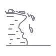

## Halo Effect

If you see a person as having a positive trait, that positive trait impression will spill over into their other traits. (This also works for negative traits.)

**Example:** "Taylor could never be mean, she's so cute!"

**Tags:** Social, Belief, Politics

## Moral Luck

Better moral standing happens due to a positive outcome; worse moral standing happens due to a negative outcome.

**Example:** "X culture won X war because they were morally superior to the losers."

**Tags:** Social, Belief, Politics, Memory

## False Consensus

We believe more people agree with us than is actually the case.

**Example:** "Everybody thinks that!"

**Tags:** Social, Belief, Politics

## Curse of Knowledge

Once we know something, we assume everyone else knows it, too.

**Example:** Alice is a teacher and struggles to understand the perspective of her new students.

**Tags:** Social, Belief, Politics, Memory

## Spotligh Effect

We overestimate how much people are paying attention to our behavior and appearance.

**Example:** Sally is worried everyone's going to notice how lame her ice cream T-shirt is.

**Tags:** Social, Memory

## Availability Heuristic

We rely on immediate examples that come to mind while making judgments.

**Example:** When trying to decide on which store to visit, you choose the one you most recently saw an ad for.

**Tags:** Belief, Learning, Memory, Politics, Money

## Defensive Attribution

As a witness who secretly fears being vulnerable to a serious mishap, we will blame the victim less and attacker more if we relate to the victim

**Example:**  Sally sat too long at a green light because she was playing with her phone. She got rear-ended. Greg, who is known to text and drive, got out and yelled at the person who smacked into her.

**Tags:** Social, Memory, Politics

## Just-World Hypothesis

We tend to believe the world is just; therefore, we assume acts of injustice are deserved.

**Example:** "Sally's purse was stolen because she was mean to Francis about their T-shirt and had bad karma."

**Tags:** Social, Memory, Politics, Belief

## Naive Realism

 We believe that we observe objective reality and that other people are irrational, uninformed, or biased.

**Example:** "see the world as it really is — other people are dumb."

**Tags:** Social, Memory, Politics, Belief

## Naive Cynicism

We believe that we observe objective reality and that other people have a higher egocentric bias than they actually do in their intentions/actions.

**Example:** "The only reason this person is doing something nice is to get something out of me."

**Tags:** Social, Memory, Politics, Belief

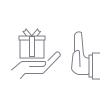

## Forer Effect

**Also known as:** Barnum Effect

We easily attribute our personalities to vague statements, even if they can apply to a wide range of people

**Example:** "This horoscope is so accurate!"

**Tags:** Memory, Belief

## Dunning-Kruger Effect

The less you know, the more confident you are. The more you know, the less confident you are.

**Example:** Francis confidently assures the group that there's no kelp in ice cream. They do not work in the dairy industry.

**Tags:** Social, Belief, Learning, Memory, Politics, Money

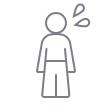

## Anchoring

We rely heavily on the first piece of information introduced when making decisions

**Example:** “That's 50% off? It must be a great deal.”

**Tags:** Learning, Belief, Memory, Money

## Automation Bias

We rely on automated systems, sometimes trusting too much in the automated correction of actually correct decisions

**Example:** Your phone auto-corrects "its" to "it's," so you assume it's right.

**Tags:** Learning, Memory, Belief

##  Google Effect

**Also known as:** Digital Amnesia

 We tend to forget information that’s easily looked up in search engines.

**Example:** "What was the name of that actor in that funny movie? I've looked it up like eight times... ."

**Tags:** Learning, Memory, Belief

## Reactance

We do the opposite of what we're told, especially when we perceive threats to personal freedoms.

**Example:** One of Alice's students refuses to do his homework, even though both she and his parents tell him to.

**Tags:** Social, Money, Politics

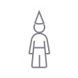

## Confirmation Bias

We tend to find and remember information that confirms our perceptions.

**Example:** You can confirm a conspiracy theory based on scant evidence while ignoring contrary evidence.

**Tags:** Learning, Memory, Belief, Politics

## Backfire Effect

Disproving evidence sometimes has the unwarranted effect of confirming our beliefs.

**Example:** The evidence that disproves your conspiracy theory was probably faked by the government.

**Tags:** Belief, Learning, Memory, Politics

## Third-Person Effect

We believe that others are more affected by mass media consumption than we ourselves are.

**Example:** "You've clearly been brainwashed by the media!"

**Tags:** Memory, Social, Learning, Belief, Politics

## Belief Bias

We judge an argument's strength not by how strongly it supports the conclusion but how plausible the conclusion is in our own minds.

**Example:** Sally mentions her supporting theory about your conspiracy theory, which you adopt wholeheartedly despite the fact that she has very litle evidence for it.

**Tags:** Belief, Learning, Memory, Politics

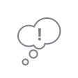

## Availability Cascade

Tied to our need for social acceptance, collective beliefs gain more plausibility through public repetition.

**Example:**  A story about razor blades appearing in candy eventually led to many people no longer offering homemade treats on Halloween in America.

**Tags:** Memory, Social, Learning, Belief, Money, Politics

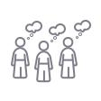

## Declinism

 We tend to romanticize the past and view the future negatively, believing that societies/institutions are by and large in decline

**Example:** "In my day, kids had more respect!"

**Tags:** Memory, Social, Belief, Politics

## Status Quo Bias

We tend to prefer things to stay the same; changes from the baseline are considered to be a loss.

**Example:** Even though an app's terms of service invade Sally's privacy, she'd rather not switch to another app.

**Tags:** Memory, Social, Learning, Belief, Money, Politics

##  Sunk Cost Fallacy

**Also known as:** Escalation of Commitment

We invest more in things that have cost us something rather than altering our investments, even if we face negative outcomes.

**Example:** "In for a penny, in for a pound!"

**Tags:** Memory, Belief, Money

## Gambler's Fallacy

We think future possibilities are affected by past events.

**Example:** Alice has lost nine coin tosses in a row, so she's sure to win the next one!

**Tags:** Memory, Belief, Money

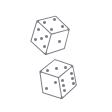

## Zero-Risk Bias

We prefer to reduce small risks to zero, even if we can reduce more risk overall with another option.

**Example:** "You should probably buy the warranty."

**Tags:** Belief, Money, Politics

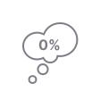

## Framing Effect

We often draw different conclusions from the same information depending on how it's presented.

**Example:** Alice hears that her favorite candidate is "killing it" with a 45% approval rating. Sally hears that the candidate is "disappointing the country" with a 45% rating. They have wildly different interpretations of the same statistic.

**Tags:** Learning, Social, Belief, Money, Politics

## Stereotyping

We adopt generalized beliefs that members of a group will have certain characteristics, despite not having information about the individual.

**Example:** "That guy with the fancy mustache is a hipster. He probably has a vinyl collection."

**Tags:** Memory, Social, Learning, Belief, Politics

## Outgroup Homogeneity Bias

We perceive out-group members as homogeneous and our own in-groups as more diverse.

**Example:** Alice is not a gamer, but she believes "all gamers are the same."

**Tags:** Memory, Social, Learning, Belief, Money, Politics

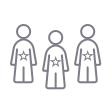

## Authority Bias

We trust and are more often influenced by the opinions of authority figures.

**Example:** "My teacher told me this was fine."

**Tags:** Social, Belief, Money, Politics

## Placebo Effect

If we believe a treatment will work, it often will have a small physiological effect.

**Example:** Alice was given a placebo for her pain, and her pain decreased.

**Tags:** Memory, Belief, Money

## Survivorship Bias

We tend to focus on those things that survived a process and overlook ones that failed

**Example:** Greg tells Alice her purse business is going to be great because a successful fashion company had the same strategy. (But 10 other failed companies also had the same strategy.)

**Tags:** Social, Belief, Money, Politics

## Tachypsychia

Our perceptions of time shift depending on trauma, drug use, and physical exertion.

**Example:** "When the car almost hit me, time slowed down ... ."

**Tags:** Memory, Learning, Belief

## Law of Triviality

**Also known as:** Bike-Shedding

We give disproportionate weight to trivial issues, often while avoiding more complex issues

**Example:** Rather than figuring out how to help the homeless, a local city government spends a lot of time discussing putting in a bike path and bike sheds.

**Tags:** Memory, Social, Money, Politics

## Zeigarnik Effect

We remember incomplete tasks more than completed ones.

**Example:** Greg feels guilty for never getting anything done, until he sees all of the tasks he's checked off on his task list.

**Tags:** Memory, Belief

## IKEA Effect

We place higher value on things we partially created ourselves.

**Example:** "Don't you love this pot I spent $20 on? I painted it myself!"

**Tags:** Social, Belief, Money

## Ben Franklin Effect

We like doing favors; we are more likely to do another favor for someone if we've already done a favor for them than if we had received a favor from that person.

**Example:** Greg loaned Francis a pen. When Francis asked to borrow $5, Greg did it readily.

**Tags:** Social, Belief, Money, Politics

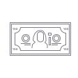

## Bystander Effect

The more other people are around, the less likely we are to help a victim.

**Example:** In a crowd of students, no one called 911 when someone got hurt in a fight.

**Tags:** Social, Money

## Suggestibility

We, especially children, sometimes mistake ideas suggested by a questioner for memories.

**Example:** "So did you fall off the couch before or after your mom hit you?"

**Tags:** Memory, Social, Learning, Belief

## False Memory

We mistake imagination for real memories.

**Example:** Greg is certain Sally said a really funny joke about pineapples, when that joke actually came from a TV show.

**Tags:** Memory, Social, Belief

## Cryptomnesia

We mistake real memories for imagination.

**Example:** Greg thinks he visited a graveyard, but he's pretty sure he just had a spooky dream.

**Tags:** Memory, Social, Belief

## Clustering Illusion

We find patterns and "clusters" in random data.

**Example:** "That cloud looks like your cat, Alice!"

**Tags:** Memory, Belief

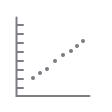

## Pressimism Bias

We sometimes overestimate the likelihood of bad outcomes.

**Example:** "Nothing will ever get better."

**Tags:** Memory, Belief

## Optimism Bias

We sometimes are over-optimisitc about good outcomes.

**Example:** "It's going to turn out great!"

**Tags:** Memory, Belief

## Blind Spot Bias

We don't think we have bias, and we see it in others more than ourselves.

**Example:** "I am not biased!"

**Tags:** Memory, Social, Learning, Belief

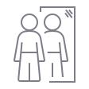
